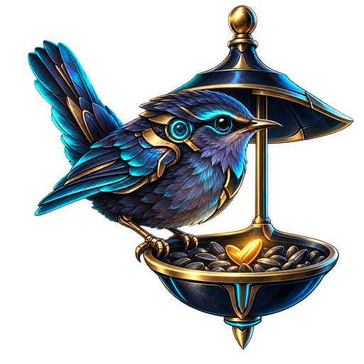

# WrenFeed

**Small quests. Good company.** WrenFeed is a compact Windows quest log for the little things worth doing in your games each day or week. Your checklist and history stay on your computer. No account, internet connection, installer, or subscription is needed to use it.

## Get started

1. Download [WrenFeed.zip](release/WrenFeed.zip). On GitHub, open the file and choose **Download raw file**. The repository's **Code → Download ZIP** is the source code, not the ready-to-run app.
2. Right-click the downloaded ZIP and choose **Extract All**. Open the extracted `WrenFeed` folder and double-click **WrenFeed.exe**.
3. Click **+ Game** to make your first quest. For a desktop shortcut, right-click the EXE and choose **Show more options → Send to → Desktop (create shortcut)**. Keep the extracted folder in place.

Windows may show an unsigned-app warning on first launch. If you trust this download, choose **More info → Run anyway**.

## At a glance

- Keep **daily and weekly quests**, each with its own reset rule, short description, and optional checkable subtasks. Group related quests under one game without tying their timers together.
- See past completions in **History**. Archive old quests without erasing their records.
- Keep the log visible over a game with **always on top** and adjustable visibility. Try nine optional [themes](themes/README.md), or stay with the original look.
- Add many quests at once with the [import template](import/README.md) or its [AI chat prompt](import/AI-PROMPT.md).
- Optionally share reviewed daily and weekly totals by game with the [WrenFeed standings](https://nullwren.github.io/WrenFeed/standings.html) using a private invite code. Uploads happen only when you press **Upload totals**.

Your progress lives separately in `%LOCALAPPDATA%\DailyQuest\journal.json`, so replacing the extracted app folder for an update keeps your list. Close WrenFeed before replacing its files. Use **Settings → Export backup** for a separate copy.

## More when you need it

[Using WrenFeed](guides/USING-WRENFEED.md) · [Files, backups, and development](guides/FILES-AND-DEVELOPMENT.md) · [Theme gallery](themes/README.md) · [Quest import guide](import/README.md) · [Public leaderboard site](https://nullwren.github.io/WrenFeed/)
