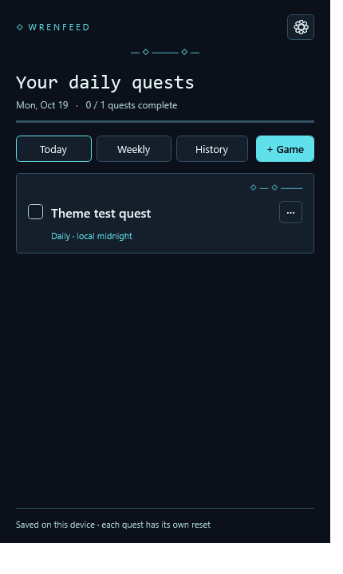
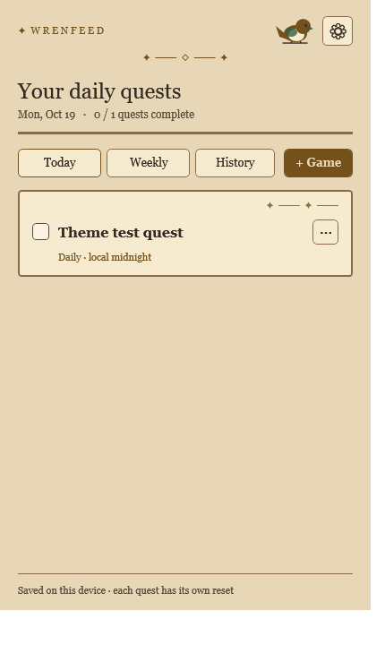
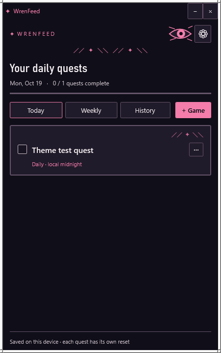
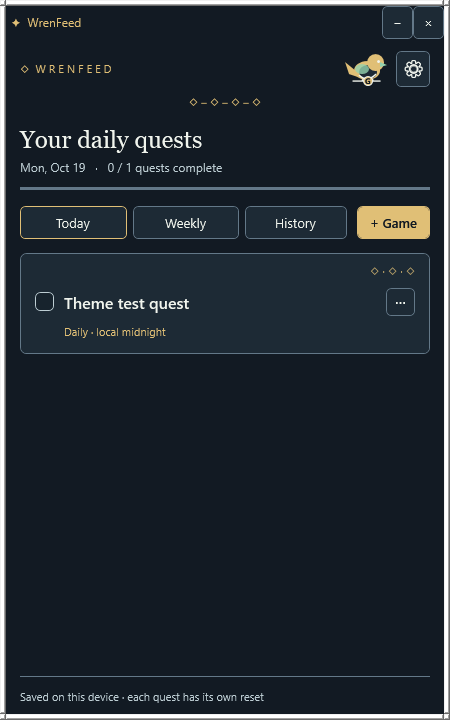
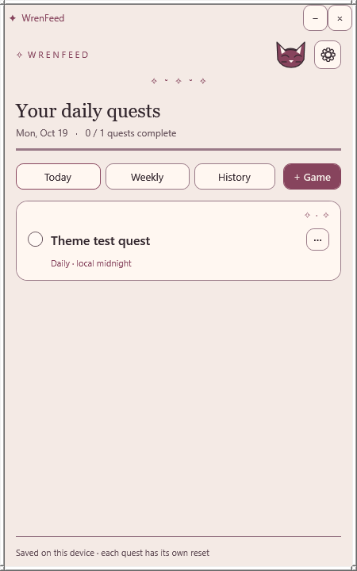
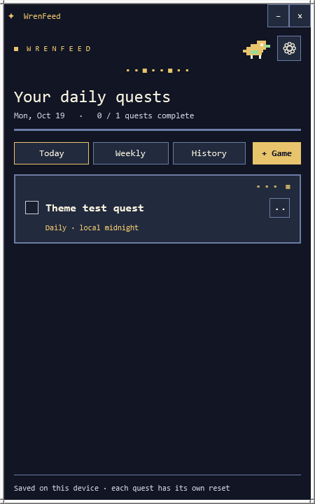
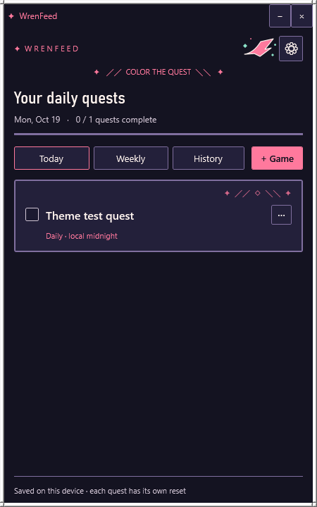
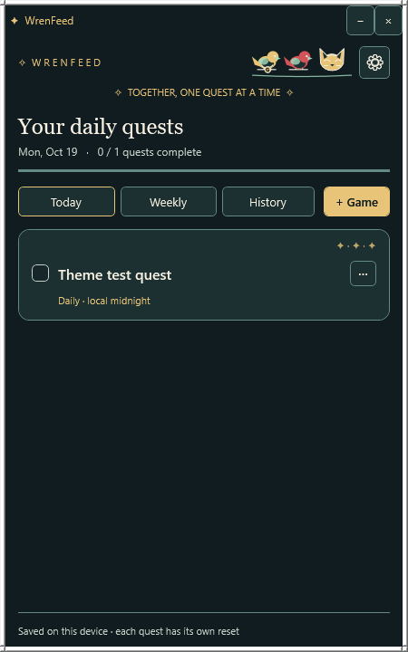

# Optional WrenFeed themes

WrenFeed keeps its original dark quest log as **Default**. These eight themes are optional, fully offline files. They change colors, fonts, borders, and small built-in decorations; they do not change quests or history.

| Neon Aviary | Adventurer's Ledger |
| --- | --- |
|  |  |
| [Neon Aviary](neon-aviary.json): midnight navy and teal circuits. | [Adventurer's Ledger](adventurers-ledger.json): parchment, brass flourishes, and a little wren. |

| Anime Noir | G-Units |
| --- | --- |
|  |  |
| [Anime Noir](anime-noir.json): original action-panel ink, sharp motion lines, and an abstract eye emblem. It uses no characters or art from an existing series. | [G-Units](g-units.json): steel blue, brass, and a wren wearing a tiny G medallion. This is a first, subtle version that can be customized later. |

| Sphynx Nook | Pixel Perch |
| --- | --- |
|  |  |
| [Sphynx Nook](sphynx-nook.json): soft rose and cream, rounded cards, and an illustrated hairless cat. | [Pixel Perch](pixel-perch.json): square retro cards, console lettering, and a pixel wren. |

| Anime Graffiti | The Flock |
| --- | --- |
|  |  |
| [Anime Graffiti](anime-graffiti.json): an original street-poster look with coral and mint spray marks, sharp cards, and a wing emblem. It uses no existing anime art or characters. | [The Flock](the-flock.json): a twilight perch shared by the G-medallion wren, a red wren, and the sphynx cat. |

To use one, open **Settings → Install theme file…**, choose its `.json` file, then select it in the **Appearance** list. If you downloaded the ready-to-run WrenFeed ZIP, the files are already in its `themes` folder. If you are browsing the GitHub repo, open a theme file and save its raw contents as a `.json` file first. Theme selection is immediate and remembered when WrenFeed reopens. Choose **Default** at any time to return to the original design.

Installed copies live in `%LOCALAPPDATA%\DailyQuest\themes\`. The original files in this repo or shareable ZIP can be deleted after installation. WrenFeed does not download themes or run code from them. Backups save the selected theme ID but do not include theme files; install the same theme file on another computer if you restore a backup there. If the selected file is missing, WrenFeed displays Default until you reinstall it or choose another theme.

To make your own, copy [template.json](template.json). You can give an AI chatbot this README and the template, then ask it to create a WrenFeed theme. Check the colors and fonts before installing. JSON requires double quotes, commas between items, and no comments or trailing commas.

| Field | Meaning |
| --- | --- |
| `format`, `version` | Exactly `"wrenfeed-theme"` and `1`. |
| `id` | Unique lowercase letters, numbers, and hyphens, starting with a letter; maximum 40 characters. `quest` is reserved for Default. |
| `name`, `description` | Display name (1–60 characters) and explanation (1–160 characters). |
| `colors` | All eight named colors from the template, each in `#RRGGBB` format. `Ink` and `Muted` must have at least 4.5:1 contrast against `Canvas`, `Panel`, and `Field`. `Accent` and `Success` must have at least 4.5:1 contrast against `Canvas`. |
| `fonts` | `body` and `display` are installed Windows font family names. WrenFeed does not download or install fonts. |
| `decoration` | `none` (original plain cards), `circuit` (angular trim), `filigree` (ornate trim), `manga` (motion lines), `chain` (linked diamonds), `whiskers` (rounded cards), `pixel` (square cards and controls), `graffiti` (spray-mark trim), or `flock` (soft group trim). |
| `mark` | A 1–4 character symbol beside the WrenFeed name. |
| `mascot` | `none`, `wren`, `chain-wren`, `sphynx`, `pixel-wren`, `manga-eye`, `graffiti-wing`, or `flock`. Each is a small built-in vector drawing in the header; theme files cannot load external images. |

The theme file is limited to 64 KB. Unknown fields and invalid colors are rejected. Installing a file with an existing theme ID can replace its installed copy after confirmation. Theme files contain only these declarative settings; there are no scripts, remote assets, or arbitrary XAML.
